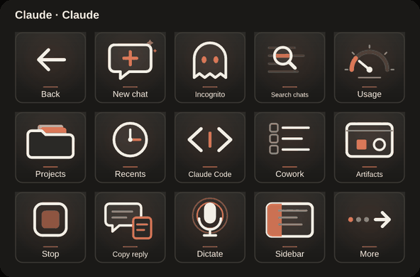
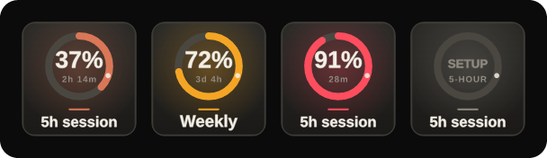
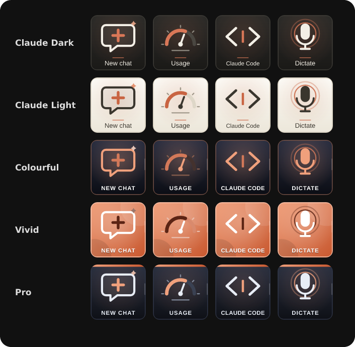
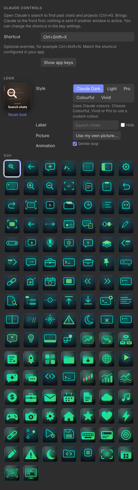

# Claude Controls

Unofficial Elgato Stream Deck plugin for the **Claude desktop app on Windows**. Version 1.2.6.0.

Keys open Claude pages **inside the desktop app** (not the browser), start chats, Claude Code sessions and Cowork tasks, and send the app's own keyboard shortcuts. Every icon is animated.



## Install in three steps

1. Download **ClaudeControls-Installer-1.2.6.0.zip** from [Releases](https://github.com/nikhilgs817/streamdeck_claude/releases/latest).
2. Right-click the ZIP, choose **Extract All**, and open the extracted folder.
3. Double-click **Install-ClaudeControls.cmd**. Wait for the success message; Stream Deck restarts automatically.

No Git, Node.js or build commands are needed. Windows Daily Toolkit is included for automatic app switching. The installer verifies files, backs up your setup, keeps your layouts and settings, and rolls back a failed update. [Full installation, update and recovery guide](docs/INSTALL.md).

## The keys

**Page 1 (Claude):** Back · New chat · Incognito · Search chats · 5h session / Projects · Recents · Claude Code · Cowork · Weekly / Stop · Dictate · Send · Copy reply · More

**Page 2 (More):** Main · Connectors · Settings · Sidebar · Find / Usage · Message box · Copy · Paste · Undo / Redo · Zoom in · Zoom out · Reset zoom · Full screen

Also in the action list: Artifacts, Shortcuts, Focus app, New window, Edit last and Custom key.

| Key | What it does | How |
|---|---|---|
| New chat | Start a chat | `claude://claude.ai/new` app link |
| Incognito | New chat, then Claude's incognito button | app link + button |
| Usage, Settings, Connectors | Open that Settings page inside the app | `claude://claude.ai/settings/...` |
| Projects, Recents, Artifacts | Open that page inside the app | `claude://claude.ai/...` |
| Claude Code, Cowork | Start a new session / task | `claude://code/new`, `claude://cowork/new` |
| Search chats | Search past chats and projects | Ctrl+K |
| Send | Send what you typed | Claude's Send button |
| Stop | Stop a reply that is still being written | Claude's Stop button |
| Copy reply | Copy Claude's latest reply | Copy button under the reply |
| Dictate | Windows voice typing into the message box | Win+H |
| Sidebar | Show or hide the chat list | Claude's sidebar button |
| Edit last / Message box | Edit your last message / put the cursor in the message box | Ctrl+Shift+; (then Up) |
| Shortcuts, Find | Claude's shortcut list / find in chat | Ctrl+/, Ctrl+F |
| Copy, Paste, Undo, Redo | Editing | Ctrl+C, Ctrl+V, Ctrl+Z, Ctrl+Shift+Z |
| Zoom in/out, Reset zoom, Full screen | Text size and window | Ctrl+=, Ctrl+-, Ctrl+0, F11 |
| Custom key | Any shortcut you type, e.g. `Ctrl+Shift+O` or `Win+H` | |

App links start Claude if it is closed. Shortcut keys first bring Claude to the front and **send nothing if another window stays in front**. You can change any shortcut in the key's settings. The app can change its shortcuts between versions; if a key stops working, enter the current shortcut in that key's settings. The plugin never reads or stores your account data.

Open or focus Claude to show these keys automatically (needs Windows Daily Toolkit); **Back** returns to your main keys. **More** and **Main** switch between the two pages.

## Usage keys (5h session, Weekly)



**5h session** and **Weekly** show how much of your Claude limits you have used: a big percentage inside a ring, the time until the window resets, and a colour that turns amber at 60 % and red at 85 %. They update every minute; press one to refresh now.

Setup (once): in your browser, open claude.ai, press F12 › Application › Cookies › `https://claude.ai`, copy the **sessionKey** value and paste it into **Session key** in either usage key's settings. It is encrypted with Windows DPAPI for your account, shared by both keys, never logged, and only sent to claude.ai. If it expires the key shows **SIGN IN**; paste a new one. These keys read the same numbers as Settings › Usage; they are not an official API.

## Appearance



| Style | Look |
|---|---|
| **Claude Dark** (default) | Warm charcoal keys, ivory line icons, clay-orange accents, bold Segoe UI labels |
| **Claude Light** | Cream paper keys with the same icons |
| **Colourful** | Coloured icons on dark glass |
| **Vivid** | White icons on a bright gradient |
| **Pro** | Restrained slate keys with a thin accent strip |

Colourful, Vivid and Pro use the new **Clay** colour by default and accept any of the 30 colours. Every icon has its own animation in a six-second loop at 12 fps (the gear turns, the usage needle sweeps, the sidebar slides, the code cursor blinks…). Labels stay still. Turn **Gentle loop** off for a still key. You can also pick another icon, change the label or use your own picture.



## Build and verify

```sh
npm ci
npm run build
npx tsc --noEmit
npm test            # SDK workflow + animation checks
npm run test:ui     # inspector (set CHROMIUM_PATH off Windows)
npm run validate
npm run pack
npm run build:installer
npm run test:installer   # Windows only
```

The installer ZIP is `dist/ClaudeControls-Installer-<version>.zip`; the plugin package is `dist/com.dailyops.claude.v1.streamDeckPlugin`. Personal profiles, credentials, account data and build output are excluded from Git. The build uses the official Rollup WASM package so it works on Windows PCs that block native parsers.

## Known limits

- Keyboard shortcuts depend on the Claude app version. App links are Claude's documented `claude://` format.
- Managed PCs that run PowerShell in Constrained Language Mode or block hidden PowerShell can stop the shortcut keys; app-link keys still need Windows to open `claude://` links.

## References

- [Open Claude Desktop with a link](https://support.claude.com/en/articles/14729294-open-claude-desktop-with-a-link)
- [Navigating the Claude desktop app](https://academy.claude.com/tutorials/navigating-the-claude-desktop-app)
- [Windows Daily Toolkit](https://github.com/nikhilgs817/windows_daily_toolkit)

Not affiliated with or endorsed by Anthropic. Claude is a trademark of Anthropic, PBC. The icons are original artwork. MIT license.
