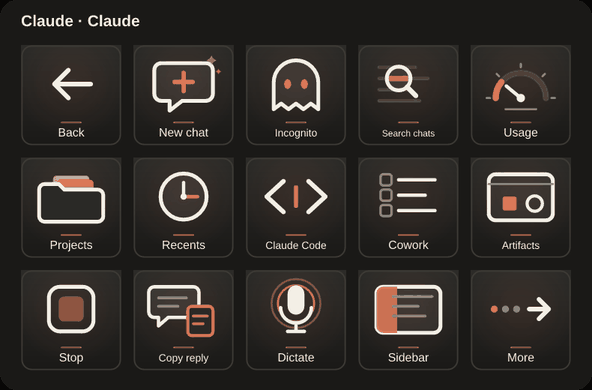
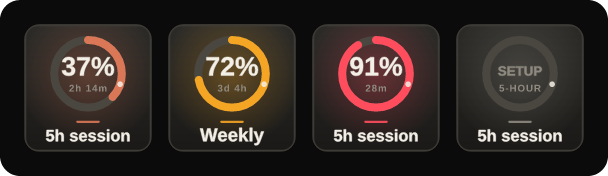
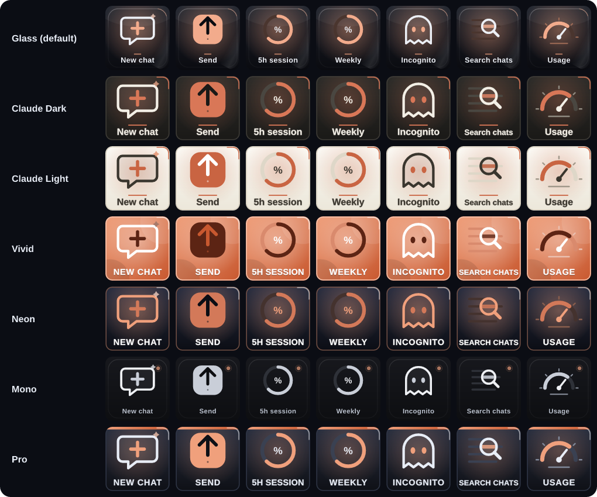
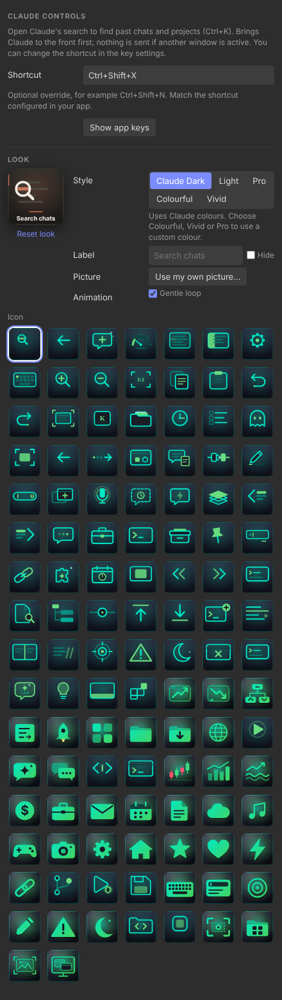

# Claude Controls

Unofficial Elgato Stream Deck plugin for the **Claude desktop app on Windows**. Version 2.1.0.0.

Keys open Claude pages **inside the desktop app** (not the browser), start chats, Claude Code sessions and Cowork tasks, and send the app's own keyboard shortcuts. Every icon is animated.



## Install in three steps

1. Download **ClaudeControls-Installer-2.1.0.0.zip** from [Releases](https://github.com/nikhilgs817/streamdeck_claude/releases/latest).
2. Right-click the ZIP, choose **Extract All**, and open the extracted folder.
3. Double-click **Install-ClaudeControls.cmd**. Wait for the success message; Stream Deck restarts automatically.

No Git, Node.js or build commands are needed. Windows Toolkit is included for automatic app switching. The installer verifies files, backs up your setup, keeps your layouts and settings, and rolls back a failed update. [Full installation, update and recovery guide](docs/INSTALL.md).

## New in 2.1: Design System 4

| What | Details |
|---|---|
| **Glass is the new default** | Frosted dark keys, a soft rim light and Title Case labels. Claude Dark, Claude Light, Vivid, Neon (formerly Colourful) and Pro are still here, plus the new **Mono** look. |
| **Custom colours** | Pick any two colours for a key instead of a theme. |
| **Motion styles** | Full, Glow only, Icon only or Still, at Slow, Calm, Normal or Fast. |
| **Glow and ripple** | Subtle, Normal or Bold glow, and a short ripple when you press a key (can be turned off per key). |
| **Labels** | Up to 18 letters, fitted to the key, in Auto, Title Case or UPPER CASE. |
| **Whole deck at once** | **Use this look on all keys** restyles every key of the plugin. |
| **Respects Windows** | Keys stop moving when Windows **Animation effects** is off (you can opt out). |

The design is shared with [Windows Toolkit](https://github.com/nikhilgs817/windows_toolkit) 3.1, so all your plugins can look the same.

## The keys

**Page 1 (Claude):** Back · New chat · Incognito · Search chats · 5h session / Projects · Recents · Claude Code · Cowork · Weekly / Stop · Dictate · Send · Copy reply · More

**Page 2 (More):** Main · Connectors · Settings · Sidebar · Find / Usage · Message box · Copy · Paste · Undo / Redo · Zoom in · Zoom out · Reset zoom · Full screen

Also in the action list: Artifacts, Shortcuts, Focus app, New window, Edit last and Custom key.

| Key | What it does | How |
|---|---|---|
| New chat | Start a chat | `claude://claude.ai/new` app link |
| Incognito | New chat, then Claude's incognito button | app link + button |
| Usage, Settings, Connectors | Open that Settings page inside the app | `claude://claude.ai/settings/...` |
| Projects, Recents, Artifacts | Open that page inside the app | `claude://claude.ai/...` |
| Claude Code, Cowork | Start a new session / task | `claude://code/new`, `claude://cowork/new` |
| Search chats | Search past chats and projects | Ctrl+K |
| Send | Send what you typed | Claude's Send button |
| Stop | Stop a reply that is still being written | Claude's Stop button |
| Copy reply | Copy Claude's latest reply | Copy button under the reply |
| Dictate | Windows voice typing into the message box | Win+H |
| Sidebar | Show or hide the chat list | Claude's sidebar button |
| Edit last / Message box | Edit your last message / put the cursor in the message box | Ctrl+Shift+; (then Up) |
| Shortcuts, Find | Claude's shortcut list / find in chat | Ctrl+/, Ctrl+F |
| Copy, Paste, Undo, Redo | Editing | Ctrl+C, Ctrl+V, Ctrl+Z, Ctrl+Shift+Z |
| Zoom in/out, Reset zoom, Full screen | Text size and window | Ctrl+=, Ctrl+-, Ctrl+0, F11 |
| Custom key | Any shortcut you type, e.g. `Ctrl+Shift+O` or `Win+H` | |

App links start Claude if it is closed. Shortcut keys first bring Claude to the front and **send nothing if another window stays in front**. You can change any shortcut in the key's settings. The app can change its shortcuts between versions; if a key stops working, enter the current shortcut in that key's settings. The plugin never reads or stores your account data.

Open or focus Claude to show these keys automatically (needs Windows Toolkit); **Back** returns to your main keys. **More** and **Main** switch between the two pages.

## Usage keys (5h session, Weekly)



**5h session** and **Weekly** show how much of your Claude limits you have used: a big percentage inside a ring, the time until the window resets, and a colour that turns amber at 60 % and red at 85 %. They update every minute; press one to refresh now.

Setup (once): in your browser, open claude.ai, press F12 › Application › Cookies › `https://claude.ai`, copy the **sessionKey** value and paste it into **Session key** in either usage key's settings. It is encrypted with Windows DPAPI for your account, shared by both keys, never logged, and only sent to claude.ai. The keys read the organization that holds your Claude plan (Max, Pro or Team first); an unused window shows 0 %. If the session key expires the key shows **SIGN IN**; paste a new one. **BLOCKED** means claude.ai refused the request; press the key to retry later. The saved key survives restarts and updates. When claude.ai ends that sign-in, Windows shows a notification and the keys show **SIGN IN**: press one to open claude.ai, copy the new sessionKey and paste it in the key settings. These keys read the same numbers as Settings › Usage; they are not an official API.

## Appearance



**Glass** is the default: frosted dark keys, a soft rim light, Title Case labels and an animated icon on every key (the gear turns, the usage needle sweeps, the sidebar slides, the code cursor blinks). Pick another look for one key, or press **Use this look on all keys** in any key's settings to restyle the whole deck.

| Style | Look |
|---|---|
| **Glass** (default) | Frosted dark glass, a quiet glow and Title Case labels |
| **Claude Dark** | Warm charcoal keys, ivory line icons, clay-orange accents, bold Segoe UI labels |
| **Claude Light** | Cream paper keys with the same icons |
| **Vivid** | White icons on a bright gradient |
| **Neon** | Coloured icons with a glowing edge on dark glass (formerly Colourful) |
| **Mono** | Monochrome icons with a single colour dot |
| **Pro** | Restrained slate keys with a thin accent strip |

Select a key in Stream Deck and open **Look**:

| Setting | Choices |
|---|---|
| **Style** | Glass (default), Claude Dark, Claude Light, Vivid, Neon, Mono or Pro |
| **Label** | Your own text (up to 18 letters, fitted to the key), Auto case / Title Case / UPPER CASE, or **Hide** |
| **Picture** | **Use my own picture…** (PNG, JPEG, GIF, SVG, WebP or BMP). **Remove picture** goes back to the drawn icon |
| **Animation** | Full, Glow only, Icon only or Still, at Slow, Calm (default), Normal or Fast |
| **Glow** | Subtle, Normal or Bold, plus **Ripple when pressed** |
| **Colour** | 42 colour themes, or two colours of your own with **Use these colours** (**Back to theme** undoes it). Claude Dark uses Claude's own colours |
| **Icon** | Swap the drawing for any of 90+ icons |

**Use this look on all keys** copies the style, animation, glow, label case and ripple to every key of this plugin, including keys on pages you can't see. Colours, icons and labels stay as they are. Change any key afterwards to give it its own look; **Reset look** (under the preview) returns a key to the defaults. Keys stay still while Windows **Settings › Accessibility › Visual effects › Animation effects** is off, unless you untick **Keep keys still when Windows animations are off**.



*This screenshot is from before version 2.1. The Look section now also has Animation, Glow, Custom colours and Use this look on all keys, as listed above.*

## Troubleshooting

- **Nothing happens when I press a key.** Shortcut keys bring Claude to the front first and send nothing if another window stays in front. Click into Claude once and press again.
- **A key does the wrong thing, or stopped working after an app update.** Claude may have changed or you may have customised that shortcut. Select the key and type the current shortcut into **Shortcut**; leave it empty to use the built-in control again.
- **The keys don't appear when I open Claude.** Automatic switching needs Windows Toolkit 2.6 or later (the installer adds it), the bundled **Claude** profile, and **Follow focus** ticked in the **Back** key's settings. You can always pick the profile yourself from Stream Deck's profile list.
- **After Back, the app keys don't come back right away.** That's on purpose: they return the next time you leave the app and come back to it.
- **The keys don't move.** Windows **Animation effects** is off, or the key's **Animation** is set to Still. Turn either back on, or untick **Keep keys still when Windows animations are off**.
- **One key looks different after "Use this look on all keys".** Colours, icons, labels and pictures are kept on purpose. Select the key and choose **Reset look** to start it fresh.
- **5h session / Weekly show SIGN IN, SETUP or BLOCKED.** See [Usage keys](#usage-keys-5h-session-weekly): paste a fresh **sessionKey**, or press the key later to retry.
- **Managed or locked-down PC.** If PowerShell runs in Constrained Language Mode or hidden PowerShell is blocked, the shortcut keys can't send keys. App-link keys still work while Windows can open their links.
- **Logs** are in `%APPDATA%\Elgato\StreamDeck\Plugins\com.windowstoolkit.claude.sdPlugin\logs`. Installer problems are covered in the [installation guide](docs/INSTALL.md#if-installation-does-not-finish).

## Data and connections

Everything runs on your PC. Keys send keyboard shortcuts to the Claude window or open `claude://` links, which Windows hands to the Claude app. The only network request the plugin makes is from the **5h session** and **Weekly** keys, which send your saved session key to claude.ai to read your usage. The session key is encrypted with Windows DPAPI for your Windows account and never logged. The plugin never reads your chats, files or account details.

Automatic app switching uses a local named pipe shared with Windows Toolkit; it carries only which plugin should show its keys, never app content or credentials. There is no telemetry. The installer downloads the matching public release from GitHub only when its package isn't already in the folder; backups and logs stay on your PC.

## Build and verify

```sh
npm ci
npm run build
npx tsc --noEmit
npm test            # SDK workflow + animation checks
npm run test:ui     # inspector (set CHROMIUM_PATH off Windows)
npm run validate
npm run pack
npm run build:installer
npm run test:installer   # Windows only
```

The installer ZIP is `dist/ClaudeControls-Installer-<version>.zip`; the plugin package is `dist/com.windowstoolkit.claude.streamDeckPlugin`. Personal profiles, credentials, account data and build output are excluded from Git. The build uses the official Rollup WASM package so it works on Windows PCs that block native parsers.

## Known limits

- Keyboard shortcuts depend on the Claude app version. App links are Claude's documented `claude://` format.
- Managed PCs that run PowerShell in Constrained Language Mode or block hidden PowerShell can stop the shortcut keys; app-link keys still need Windows to open `claude://` links.

## References

- [Open Claude Desktop with a link](https://support.claude.com/en/articles/14729294-open-claude-desktop-with-a-link)
- [Navigating the Claude desktop app](https://academy.claude.com/tutorials/navigating-the-claude-desktop-app)
- [Windows Toolkit](https://github.com/nikhilgs817/windows_toolkit)

Not affiliated with or endorsed by Anthropic. Claude is a trademark of Anthropic, PBC. The icons are original artwork. MIT license.
